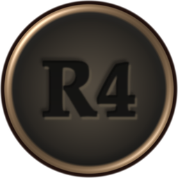
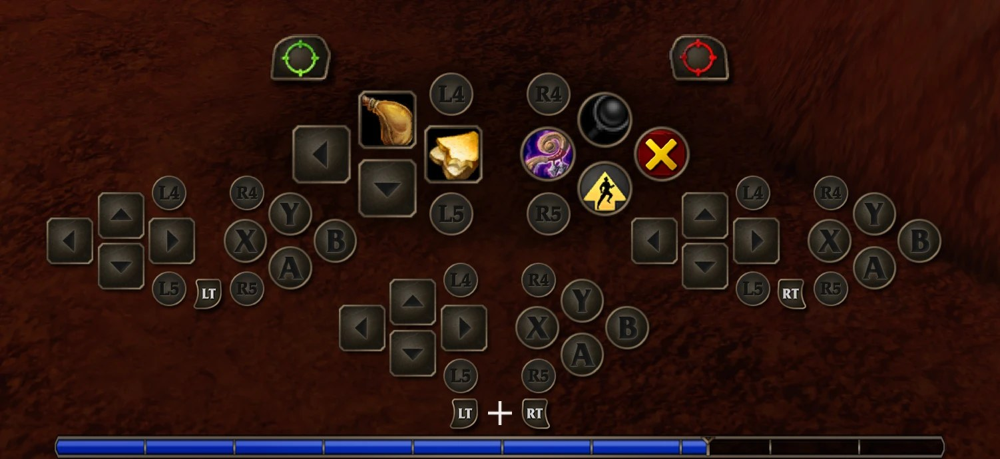

# Gripbar

Back paddles and grip buttons as extra slots on the native gamepad crossbar of **World of Warcraft: Forever**.

Forever's crossbar gives you the d-pad and the face buttons on four layers (no trigger, LT, RT, LT + RT). Gripbar adds four more slots to every layer for the extra buttons on the back of your controller (Steam Controller and Steam Deck grips, Xbox Elite and Scuf paddles, DualSense Edge back and Fn buttons, Razer M buttons): 16 more actions without taking your thumbs off the sticks. The slots sit around each bar, use Blizzard's own crossbar art, and expand, fade and page together with the native bars.

## Features

- **Slots on the crossbar.** Two slots by the d-pad and two by the face buttons on each bar. The focused bar grows from its centre like the native slots; unfocused bars fade with the game's own.
- **Crossbar pages.** Paddle slots follow the native crossbar page (1-3): each page has its own 16 actions, switched right before every press, so it works in combat.
- **Controller profiles.** Names and engraved glyphs drawn in the style of the native A / B / X / Y slots:

  | Profile | Top row | Bottom row |
  |---|---|---|
  | Steam Controller / Steam Deck (`steam`) | L4, R4 | L5, R5 |
  | Xbox Elite / Scuf (`elite`) | P1, P2 | P3, P4 |
  | DualSense Edge (`edge`) | Fn L, Fn R | Back L, Back R |
  | Razer Wolverine / Kishi (`razer`) | M1, M2 | M3, M4 |
  | Generic (`generic`) | P1, P2 | P3, P4 |

- **Swap melee and wand.** With a wand equipped and a living enemy targeted, X shoots the wand and RB + X swings the melee weapon (the game has them the other way round). Looting, NPCs and LT / RT + X stay the game's. Works on every client language.
- **Page binds.** Keys that fire a button's slot on crossbar page 2 or 3 without switching to it, on whichever LT / RT layer is held. Handy with Steam Input long presses on rarely used buttons.
- **Paging paddles.** A paddle can page the crossbar (previous / next) instead of firing its slots.
- **Native badge offsets.** Move the crossbar's own LT, RT and LT + RT prompts.

## Setup

1. **Map each extra button to a key WoW does not use.** On Windows the paddles and grips reach the game only through Steam Input, the Xbox Accessories app or reWASD. Good choices: F6-F12 (free F12 from Steam's screenshot shortcut first), Numpad / and Numpad \*. Avoid Numpad digits: they change with Num Lock.
2. In game: **Settings > AddOns > Gripbar**, pick your **Controller**, then **Assign all** and press each button in turn (or `/grip assign`).
3. Drag spells, items or macros onto the slots. Hold LT, RT or both to fill the other layers.

`/grip guide` opens a step-by-step guide with a live readout of what the game receives.

## Settings

Settings > AddOns > Gripbar, or `/grip`:

- **Combat:** swap melee and wand.
- **HUD:** slot size, inactive panel opacity, horizontal / vertical spread of the top and bottom rows, native badge offsets.
- **Paddles:** controller profile, each paddle's input and what it does, setup guide.
- **Page binds:** keys for pages 2 and 3.
- **Diagnostics.**

## Commands

| Command | |
|---|---|
| `/grip` | Open the settings |
| `/grip assign [1-4]` | Assign one paddle, or all four in order, by pressing it |
| `/grip keys [P1 P2 P3 P4 \| reset]` | Show or set the paddle inputs |
| `/grip controller [auto\|steam\|elite\|edge\|razer\|generic]` | Controller profile |
| `/grip paddle [1-4] [actions\|prev\|next]` | What a paddle does |
| `/grip spread [top\|bottom] [x y] \| reset` | Slot distance from the bar centre |
| `/grip badge [lt\|rt\|both] [x y \| reset]` | Move the native trigger badges |
| `/grip binds [assign <2\|3> \| clear [2\|3]]` | Page 2 / 3 binds |
| `/grip wand` | Toggle the melee / wand swap |
| `/grip clear <base\|lt\|rt\|both> <1-4>` | Clear one slot |
| `/grip guide` | Setup guide |
| `/grip diag [copy]` | Diagnostics |
| `/grip test`, `/grip learn` | Raw controller input tools |

## Notes

- Built for **WoW: Forever** (Interface 16001) and its native gamepad crossbar; it does nothing on other clients.
- Actions live in the game's own gamepad action storage, per character. Settings are account-wide.
- Do not run it together with SNRN Backhand: both would bind the same keys.
- If you use Improved Forever, turn off its "Square shoots the wand" when you use the swap here.

## Credits

**A huge thank you to SillyNameRandomNumber ([snrn-Pontus](https://github.com/snrn-Pontus)), the author of [SNRN Backhand](https://github.com/snrn-Pontus/Backhand).**

Gripbar is a fork of Backhand 0.9.1 and would not exist without it. Backhand solved the hard parts: getting controller paddles into WoW: Forever at all, the secure paddle bindings that work in combat, the LT / RT layer driver, storing actions in the game's own gamepad action storage, paging the native crossbar, the settings page and the diagnostics. Gripbar builds its layout, profiles and extras on top of that work. Backhand is released under the MIT License, and its copyright notice is kept in [LICENSE](LICENSE).

If you like Gripbar, please also have a look at Backhand and the other SNRN addons: [Rummage](https://github.com/snrn-Pontus/Rummage), [Tally](https://github.com/snrn-Pontus/Tally), [Valet](https://github.com/snrn-Pontus/Valet) and [Grimoire](https://github.com/snrn-Pontus/Grimoire).

The glyph textures (`Media/Glyph*.tga`) and the addon icon are drawn by `tools/glyphs.py`; no game art is copied.

## License

MIT, see [LICENSE](LICENSE).
